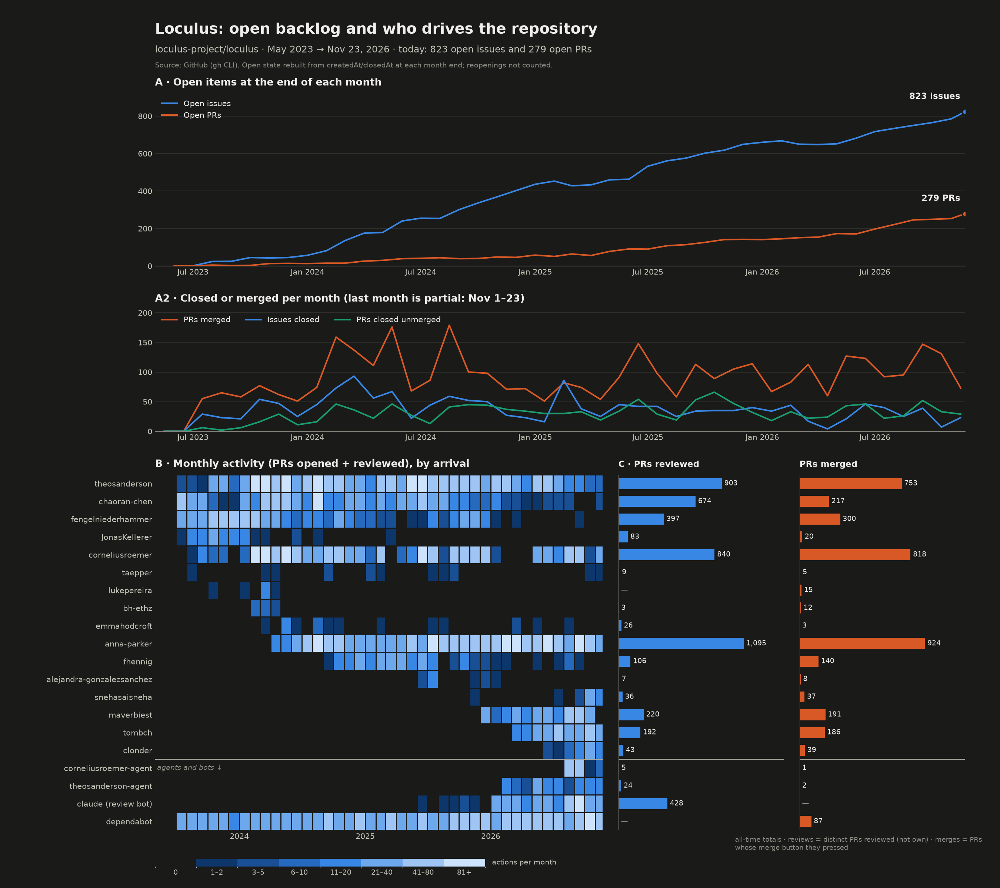
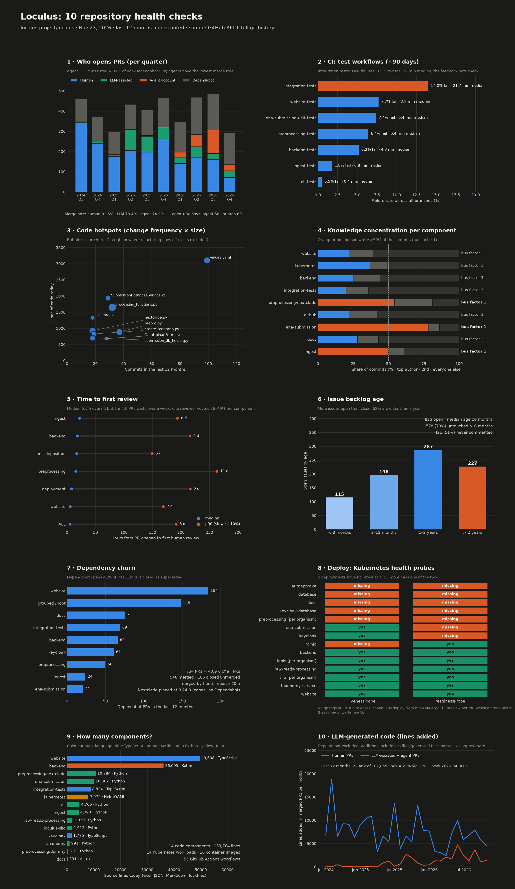
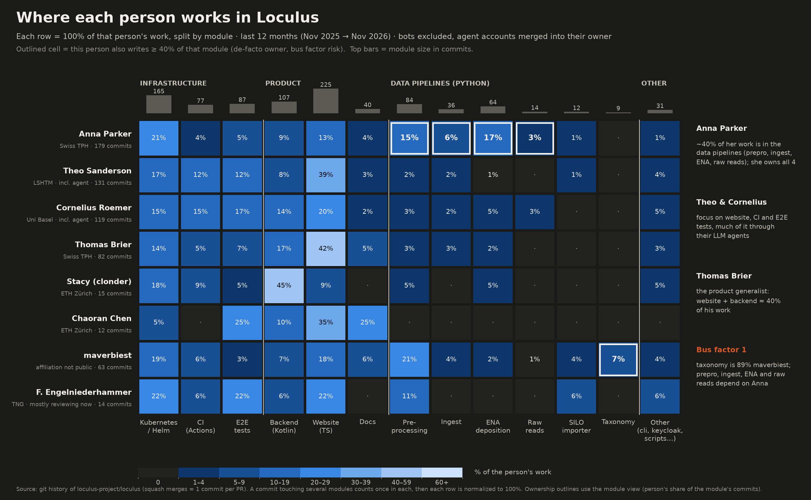
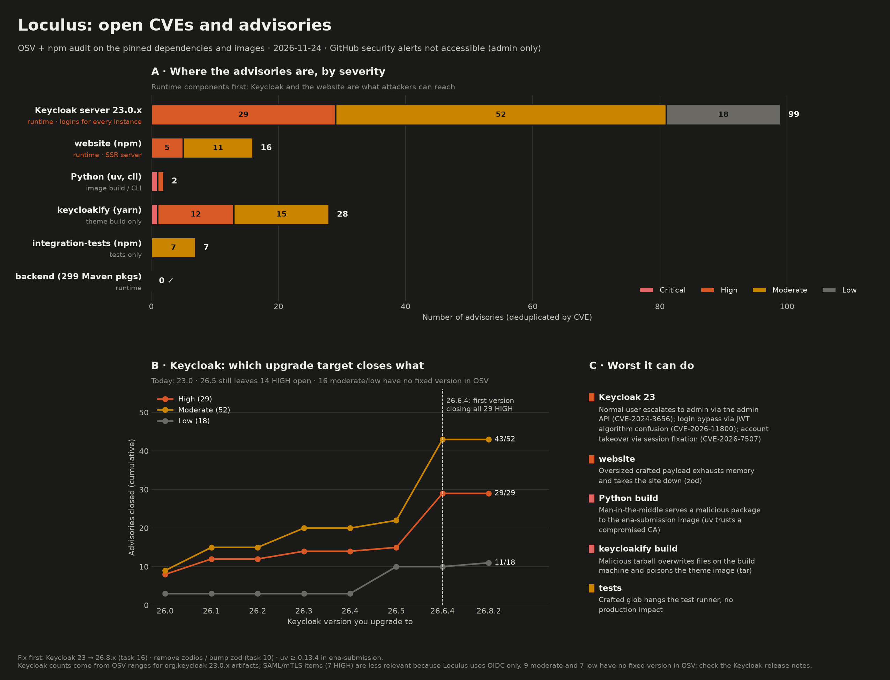

# Loculus: visual analyses

> Built on 23–24 November 2026 from the GitHub API and the full git history of `loculus-project/loculus`.
> The findings behind each chart, the contribution backlog and the full write-ups are linked under [Dive deeper](#dive-deeper).

## 1. Backlog and who drives the repository

**What it shows**
- **A · Open items:** open issues grow steadily since 2023 (823 today); open PRs accelerate from Jul 2026 (279), when agent accounts start opening PRs at scale.
- **A2 · Closed/merged per month:** 60–180 PRs merged per month (3,887 in total), but only 20–50 issues closed. More issues open than close. ~25% of finished PRs are closed without merge.
- **B · Monthly activity per person** (PRs opened + reviewed), in order of arrival: a stable core (Theo Sanderson, Cornelius Roemer, Anna Parker), newer people (maverbiest, Thomas Brier, Stacy), Dependabot throughout, and an automated code-review bot active from 2026.
- **C · All-time totals:** Anna Parker reviews (1,095) and merges (924) the most. Chaoran Chen reviews a lot but merges little. The automated review bot only comments (428 reviews, 0 merges).

## 2. Repository health checks (10 panels)

| Panel | Takeaway |
|---|---|
| 1 · Who opens PRs | Agent + LLM-assisted PRs = **37%** of non-Dependabot PRs; agent PRs have the lowest merge rate (74% vs 83% for humans) |
| 2 · CI | **Integration tests are the bottleneck:** 14% failures, 22 min median. Unit test workflows take 0.4–4 min |
| 3 · Hotspots | `values.yaml` (3.1k lines, 99 commits/year), `SubmissionDatabaseService.kt` (1.9k lines), `processing_functions.py` |
| 4 · Knowledge concentration | **Bus factor 1** in preprocessing, ENA deposition and ingest |
| 5 · Time to first review | Median 5.5 h, but **p90 ≈ 8 days**; one reviewer covers 36–49% per component |
| 6 · Backlog age | 825 open issues, median age **16 months**, 70% untouched for 6+ months |
| 7 · Dependency churn | Dependabot opens **41%** of all PRs; 1 in 4 is closed as superseded |
| 8 · Health probes | 5 deployments without probes, 3 missing one of the two; no releases or tags (continuous deploy via ArgoCD) |
| 9 · Components | **14** code components, ~140k lines: website (TS) + backend (Kotlin) are 60%; the rest is mostly Python |
| 10 · LLM-generated code | **21%** of lines added in the last 12 months came through LLM/agent PRs (peak 47% in Apr 2026) |

## 3. Where each person works

**How to read it:** each **row sums to 100%** of that person's work in the last 12 months, split by module (agent accounts merged into their owner). An **outlined cell** means the person also writes ≥ 40% of that module's commits, i.e. a de-facto owner and a bus-factor risk.

**Takeaways**
- **Anna Parker:** ~40% of her work is in the data pipelines, and she owns all four (preprocessing, ingest, ENA, raw reads). She also leads Kubernetes (37% of that module).
- **Theo Sanderson & Cornelius Roemer:** website, CI and E2E tests, much of it through their LLM agents.
- **Thomas Brier:** the product generalist (website + backend ≈ 40% of his work).
- **Bus factor 1:** taxonomy is 89% maverbiest; the pipelines depend on Anna.
- **Keycloak:** 1 human commit in 12 months, so nobody owns it (see [`auth-options.md`](auth-options.md) and task 16).

## 4. Open CVEs and advisories

- **Keycloak 23.0.x:** 99 advisories (29 high). Upgrading to **≥ 26.6.4** closes all HIGH; 26.5 still leaves 14 open. 16 moderate/low have no fixed version in OSV.
- **The website** (runtime) has 5 HIGH through `zod`/`@zodios`. The keycloakify findings are build-time only. **The backend has 0.**

## Caveats
- **LLM share** is detected from PR text, branch names and agent accounts, so it's a lower bound.
- **Open counts** are rebuilt from created/closed dates, so reopenings are ignored (823/279 vs the live 825/278).
- **Commit-based shares:** with squash merges, 1 commit ≈ 1 PR. Young modules (raw reads, SILO importer, taxonomy) have few commits.
- **People:** only public professional information is used. Short pauses in activity are not treated as people leaving.

## Dive deeper

- [Bottlenecks and optimization opportunities](bottlenecks.md)
- [Tasks: 18 concrete contributions](../tasks/README.md)
- [Data map: where data lives](data-map.md)
- [Python pipelines](python-pipelines.md)
- [CVEs and advisories](cves.md)
- [Security review](security.md)
