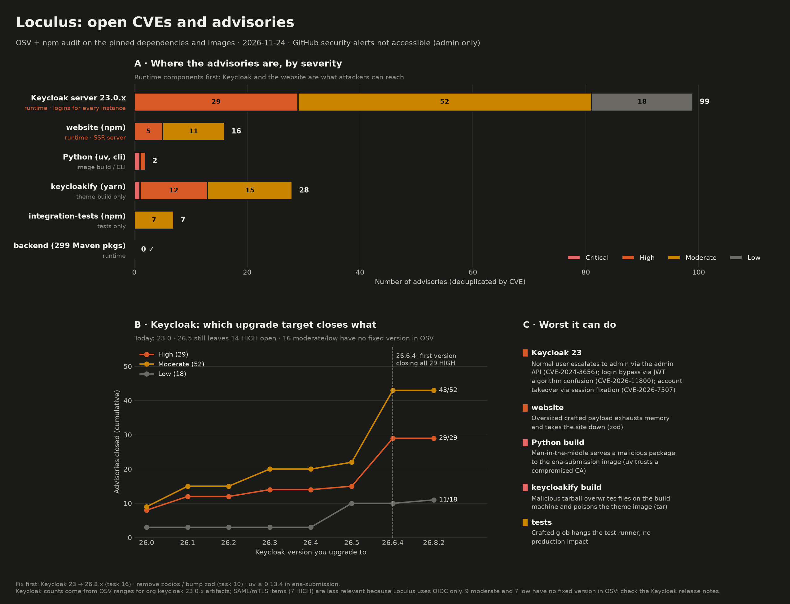

# Loculus: CVE and advisory lists

> Snapshot from 2026-11-24. Sources: [OSV](https://osv.dev) API (Maven, PyPI and npm packages pinned in the repo) and `npm audit --package-lock-only`.
> GitHub's own Dependabot and code-scanning alerts were **not accessible** (they need admin rights on the repo), so this list can differ from the repo's security tab.
> Related: task [16](../tasks/16-keycloak-26-orcid.md) (Keycloak 26), task [10](../tasks/10-client-responsiveness.md) (zodios/zod), task [14](../tasks/14-dependency-automation.md) and `maintainer-docs/security_updates_sop.md` (process).

## Summary

| Where | Findings | Highest | Worst it can do |
|---|---|---|---|
| **Keycloak server 23.0.x** (`values.yaml` image tag) | 99 advisories: 29 high, 52 moderate, 18 low | HIGH | A normal user **escalates to admin** through the admin API (CVE-2024-3656), or an attacker **bypasses login / takes over accounts** (JWT algorithm confusion CVE-2026-11800, session fixation CVE-2026-7507) |
| website (`npm audit`) | 16: 5 high, 11 moderate | HIGH | An oversized crafted payload **exhausts memory and takes the website down** (`zod`, DoS) |
| integration-tests (`npm audit`) | 7: 7 moderate | MODERATE | A crafted glob **hangs the test runner** (ReDoS); no production impact |
| keycloakify theme build (`yarn.lock`) | 28: 1 critical, 12 high, 15 moderate | CRITICAL | A malicious tarball **writes or overwrites files on the build machine** (`tar` path traversal), poisoning the theme image |
| Python (`uv.lock`, `environment.yml`) | 3 | CRITICAL | A **man-in-the-middle serves a malicious package** to the ena-submission image build (`uv` trusts a compromised CA) |
| backend runtime (299 Maven packages) | 0 | — | — |

**Fix first:** (1) Keycloak 23 → 26.8.x; (2) the website `zod`/`@zodios` HIGH findings (runtime DoS); (3) `uv` in ena-submission (one-line bump). The keycloakify findings are build-time only, so they come last.

## 1. Keycloak server 23.0.x (99 advisories)

All 29 HIGH are fixed in the 26 line, and several need **≥ 26.6.4**. **16 moderate/low advisories have no fixed version in OSV** ("—" in the table); check them against the Keycloak release notes, because they may be fixed but not mapped, or still unfixed. The "Relevance" column is a first triage: Loculus uses OIDC only, not SAML or mTLS.

### High (29)

| CVE | Summary | Fixed in | Relevance | Advisory |
|---|---|---|---|---|
| CVE-2023-6841 | Keycloak Denial of Service vulnerability | 24.0.0 | applies | [GHSA-w97f-w3hq-36g2](https://osv.dev/vulnerability/GHSA-w97f-w3hq-36g2) |
| CVE-2024-10039 | Keycloak mTLS Authentication Bypass via Reverse Proxy TLS Termination  | 26.0.6 | low: mTLS / build-time | [GHSA-93ww-43rr-79v3](https://osv.dev/vulnerability/GHSA-93ww-43rr-79v3) |
| CVE-2024-10270 | org.keycloak:keycloak-services has Inefficient Regular Expression Complexity | 26.0.6 | applies | [GHSA-wq8x-cg39-8mrr](https://osv.dev/vulnerability/GHSA-wq8x-cg39-8mrr) |
| CVE-2024-10451 | Keycloak Build Process Exposes Sensitive Data | 26.0.6 | low: mTLS / build-time | [GHSA-v7gv-xpgf-6395](https://osv.dev/vulnerability/GHSA-v7gv-xpgf-6395) |
| CVE-2024-1132 | Keycloak path traversal vulnerability in redirection validation | 22.0.10, 24.0.3 | applies | [GHSA-72vp-xfrc-42xm](https://osv.dev/vulnerability/GHSA-72vp-xfrc-42xm) |
| CVE-2024-1249 | Keycloak's unvalidated cross-origin messages in checkLoginIframe leads to DDoS | 22.0.10, 24.0.3 | applies | [GHSA-m6q9-p373-g5q8](https://osv.dev/vulnerability/GHSA-m6q9-p373-g5q8) |
| CVE-2024-2419 | Keycloak path traversal vulnerability in the redirect validation | 22.0.10, 24.0.3 | applies | [GHSA-mrv8-pqfj-7gp5](https://osv.dev/vulnerability/GHSA-mrv8-pqfj-7gp5) |
| CVE-2024-3656 | Keycloak's admin API allows low privilege users to use administrative functions | 24.0.5 | applies | [GHSA-2cww-fgmg-4jqc](https://osv.dev/vulnerability/GHSA-2cww-fgmg-4jqc) |
| CVE-2024-4540 | Keycloak exposes sensitive information in Pushed Authorization Requests (PAR) | 24.0.5 | applies | [GHSA-69fp-7c8p-crjr](https://osv.dev/vulnerability/GHSA-69fp-7c8p-crjr) |
| CVE-2024-7341 | Keycloak has session fixation in Elytron SAML adapters | 22.0.12, 24.0.7 | low: SAML is not used | [GHSA-5rxp-2rhr-qwqv](https://osv.dev/vulnerability/GHSA-5rxp-2rhr-qwqv) |
| CVE-2024-8698 | Improper Verification of SAML Responses Leading to Privilege Escalation in Keycloak | 22.0.13, 24.0.8 | low: SAML is not used | [GHSA-xgfv-xpx8-qhcr](https://osv.dev/vulnerability/GHSA-xgfv-xpx8-qhcr) |
| CVE-2025-3501 | Keycloak hostname verification | 26.2.2 | applies | [GHSA-hw58-3793-42gg](https://osv.dev/vulnerability/GHSA-hw58-3793-42gg) |
| CVE-2026-11800 | Keycloak has authentication bypass via jwt algorithm confusion | 26.6.4 | applies | [GHSA-j97h-3f8r-mrjr](https://osv.dev/vulnerability/GHSA-j97h-3f8r-mrjr) |
| CVE-2026-1486 | Keycloak fails to verify if an Identity Provider (IdP) is enabled before issuing tokens | 26.4.9, 26.5.3 | applies | [GHSA-37gf-gmxv-74wv](https://osv.dev/vulnerability/GHSA-37gf-gmxv-74wv) |
| CVE-2026-1529 | Keycloak affected by improper invitation token validation | 26.2.13, 26.4.9 | applies | [GHSA-hcvw-475w-8g7p](https://osv.dev/vulnerability/GHSA-hcvw-475w-8g7p) |
| CVE-2026-2092 | Keycloak: Unauthorized access via improper validation of encrypted SAML assertions | 26.5.5 | low: SAML is not used | [GHSA-794g-x443-36f7](https://osv.dev/vulnerability/GHSA-794g-x443-36f7) |
| CVE-2026-2603 | Keycloak: Unauthorized authentication via disabled SAML Identity Provider | 26.5.5 | low: SAML is not used | [GHSA-x4p7-7chp-64hq](https://osv.dev/vulnerability/GHSA-x4p7-7chp-64hq) |
| CVE-2026-3009 | Keycloak allows authentication using an Identity Provider (IdP) even after it has been disabled by an administ | 26.5.5 | applies | [GHSA-m297-3jv9-m927](https://osv.dev/vulnerability/GHSA-m297-3jv9-m927) |
| CVE-2026-3872 | Keycloak: Redirect URI validation bypass via ..;/ path traversal in OIDC auth endpoint | 26.5.7 | applies | [GHSA-cjm2-j6cm-6p6m](https://osv.dev/vulnerability/GHSA-cjm2-j6cm-6p6m) |
| CVE-2026-4282 | Keycloak: Privilege escalation via forged authorization codes due to SingleUseObjectProvider isolation flaw | 26.5.7 | applies | [GHSA-hj93-h7pg-fh6v](https://osv.dev/vulnerability/GHSA-hj93-h7pg-fh6v) |
| CVE-2026-4634 | Keycloak: Application-Level DoS via Scope Processing | 26.5.7 | applies | [GHSA-h4wv-g838-66g3](https://osv.dev/vulnerability/GHSA-h4wv-g838-66g3) |
| CVE-2026-4636 | Keycloak: UMA Policy Resource Injection Allows Unauthorized Cross-User Permission Grants | 26.5.7 | applies | [GHSA-f2hx-5fx3-hmcv](https://osv.dev/vulnerability/GHSA-f2hx-5fx3-hmcv) |
| CVE-2026-7307 | Keycloak: Denial of Service via specially crafted SAML input | 26.6.2 | low: SAML is not used | [GHSA-p5mv-gj8j-xqgf](https://osv.dev/vulnerability/GHSA-p5mv-gj8j-xqgf) |
| CVE-2026-7504 | Keycloak: Open redirect when using wildcard valid redirect URIs in Keycloak | 26.6.2 | applies | [GHSA-rp95-xpg9-c2cq](https://osv.dev/vulnerability/GHSA-rp95-xpg9-c2cq) |
| CVE-2026-7507 | Keycloak: Session fixation in OIDC login flow that can lead to account takeover | 26.6.2 | applies | [GHSA-hf67-5vvq-fm3r](https://osv.dev/vulnerability/GHSA-hf67-5vvq-fm3r) |
| CVE-2026-7571 | Keycloak: Access token disclosure and implicit flow bypass via forged client data | 26.6.2 | applies | [GHSA-hq3p-w4xv-x7vp](https://osv.dev/vulnerability/GHSA-hq3p-w4xv-x7vp) |
| CVE-2026-9086 | Keycloak vulnerable to cross-site scripting (xss) via case-insensitive uri validation bypass | 26.6.4 | applies | [GHSA-v3f7-2p4r-mwfw](https://osv.dev/vulnerability/GHSA-v3f7-2p4r-mwfw) |
| CVE-2026-9795 | Keycloak has privilege escalation via improper scope mapping enforcement | 26.6.4 | applies | [GHSA-32h4-44jj-c5vx](https://osv.dev/vulnerability/GHSA-32h4-44jj-c5vx) |
| CVE-2026-9800 | Keycloak vulnerable to authorization bypass via incorrect uri comparison | 26.0.10, 26.6.4 | applies | [GHSA-f5p5-6xmx-p252](https://osv.dev/vulnerability/GHSA-f5p5-6xmx-p252) |

### Moderate (52)

| CVE | Summary | Fixed in | Relevance | Advisory |
|---|---|---|---|---|
| CVE-2023-3597 | Keycloak secondary factor bypass in step-up authentication | 22.0.10, 24.0.3 | applies | [GHSA-4f53-xh3v-g8x4](https://osv.dev/vulnerability/GHSA-4f53-xh3v-g8x4) |
| CVE-2023-6544 | Keycloak Authorization Bypass vulnerability | 22.0.10, 24.0.3 | applies | [GHSA-46c8-635v-68r2](https://osv.dev/vulnerability/GHSA-46c8-635v-68r2) |
| CVE-2023-6717 | Keycloak Cross-site Scripting (XSS) via assertion consumer service URL in SAML POST-binding flow | 22.0.10, 24.0.3 | low: SAML is not used | [GHSA-8rmm-gm28-pj8q](https://osv.dev/vulnerability/GHSA-8rmm-gm28-pj8q) |
| CVE-2023-6787 | Keycloak vulnerable to session hijacking via re-authentication | 22.0.10, 24.0.3 | applies | [GHSA-c9h6-v78w-52wj](https://osv.dev/vulnerability/GHSA-c9h6-v78w-52wj) |
| CVE-2024-10492 | Keycloak Path Traversal Vulnerability Due to External Control of File Name or Path | 26.0.6 | applies | [GHSA-5545-r4hg-rj4m](https://osv.dev/vulnerability/GHSA-5545-r4hg-rj4m) |
| CVE-2024-11734 | Denial of Service in Keycloak Server via Security Headers | 26.0.8 | applies | [GHSA-w3g8-r9gw-qrh8](https://osv.dev/vulnerability/GHSA-w3g8-r9gw-qrh8) |
| CVE-2024-11736 | Keycloak allows unrestricted admin use of system and environment variables | 26.0.8 | applies | [GHSA-f4v7-3mww-9gc2](https://osv.dev/vulnerability/GHSA-f4v7-3mww-9gc2) |
| CVE-2024-4629 | Keycloak Services has a potential bypass of brute force protection | 22.0.12, 24.0.7 | applies | [GHSA-gc7q-jgjv-vjr2](https://osv.dev/vulnerability/GHSA-gc7q-jgjv-vjr2) |
| CVE-2024-7260 | Keycloak Open Redirect vulnerability | 24.0.7 | applies | [GHSA-g4gc-rh26-m3p5](https://osv.dev/vulnerability/GHSA-g4gc-rh26-m3p5) |
| CVE-2024-7318 | Keycloaks's One Time Passcode (OTP) is valid longer than expiration timeSeverity | 24.0.7, 25.0.4 | applies | [GHSA-xmmm-jw76-q7vg](https://osv.dev/vulnerability/GHSA-xmmm-jw76-q7vg) |
| CVE-2024-8883 | Keycloak has Vulnerable Redirect URI Validation Results in Open Redirect | 22.0.13, 24.0.8 | applies | [GHSA-w8gr-xwp4-r9f7](https://osv.dev/vulnerability/GHSA-w8gr-xwp4-r9f7) |
| CVE-2024-9666 | Keycloak proxy header handling Denial-of-Service (DoS) vulnerability | 26.0.6 | applies | [GHSA-jgwc-jh89-rpgq](https://osv.dev/vulnerability/GHSA-jgwc-jh89-rpgq) |
| CVE-2025-11429 | Keycloak does not invalidate sessions when "Remember Me" is disabled | 26.2.11, 26.4.1 | applies | [GHSA-64w3-5q9m-68xf](https://osv.dev/vulnerability/GHSA-64w3-5q9m-68xf) |
| CVE-2025-11537 | Keycloak logs sensitive headers | 26.5.6 | applies | [GHSA-gv3v-2cpp-3pmq](https://osv.dev/vulnerability/GHSA-gv3v-2cpp-3pmq) |
| CVE-2025-12110 | Keycloak does not invalidate offline sessions when the offline_access scope is removed | 26.2.3 | applies | [GHSA-895x-rfqp-jh5c](https://osv.dev/vulnerability/GHSA-895x-rfqp-jh5c) |
| CVE-2025-12390 | Keycloak vulnerable to session takeovers due to reuse of session identifiers | 26.0.0 | applies | [GHSA-rg35-5v25-mqvp](https://osv.dev/vulnerability/GHSA-rg35-5v25-mqvp) |
| CVE-2025-1391 | Improper Authorization in Keycloak Organization Mapper Allows Unauthorized Organization Claims  | 26.0.10, 26.1.3 | applies | [GHSA-gvgg-2r3r-53x7](https://osv.dev/vulnerability/GHSA-gvgg-2r3r-53x7) |
| CVE-2025-14559 | Keycloak services allows the issuance of access and refresh tokens for disabled users | 26.4.9, 26.5.2 | applies | [GHSA-wv3h-x6c4-r867](https://osv.dev/vulnerability/GHSA-wv3h-x6c4-r867) |
| CVE-2025-14778 | Keycloak Affected by Broken Access Control Vulnerability in the UserManagedPermissionService | 26.2.13, 26.4.9 | applies | [GHSA-fm6w-rrp3-2x4w](https://osv.dev/vulnerability/GHSA-fm6w-rrp3-2x4w) |
| CVE-2025-2559 | Keycloak Denial of Service (DoS) Vulnerability via JWT Token Cache | — | applies | [GHSA-2935-2wfm-hhpv](https://osv.dev/vulnerability/GHSA-2935-2wfm-hhpv) |
| CVE-2025-3910 | Keycloak vulnerable to two factor authentication bypass | 26.2.2 | applies | [GHSA-5jfq-x6xp-7rw2](https://osv.dev/vulnerability/GHSA-5jfq-x6xp-7rw2) |
| CVE-2025-7365 | Keycloak phishing attack via email verification step in first login flow | 26.0.13, 26.2.6 | applies | [GHSA-xhpr-465j-7p9q](https://osv.dev/vulnerability/GHSA-xhpr-465j-7p9q) |
| CVE-2025-8419 | Keycloak SMTP Inject Vulnerability | 26.2.8, 26.3.3 | applies | [GHSA-m4j5-5x4r-2xp9](https://osv.dev/vulnerability/GHSA-m4j5-5x4r-2xp9) |
| CVE-2026-0871 | Keycloak Server Private SPI: Improper Access Control Allows Administrators to Bypass Attribute Visibility Rest | 26.5.2 | applies | [GHSA-v4jw-m6rm-399h](https://osv.dev/vulnerability/GHSA-v4jw-m6rm-399h) |
| CVE-2026-2575 | Keycloak: Denial of Service due to excessive SAMLRequest decompression | 26.5.4 | low: SAML is not used | [GHSA-xv6h-r36f-3gp5](https://osv.dev/vulnerability/GHSA-xv6h-r36f-3gp5) |
| CVE-2026-3121 | Keycloak: manage-clients permission escalates to full realm admin access | 26.5.6 | applies | [GHSA-7xf9-4jfc-wgm4](https://osv.dev/vulnerability/GHSA-7xf9-4jfc-wgm4) |
| CVE-2026-3190 | Keycloak: Missing Role Enforcement on UMA 2.0 Permission Ticket Endpoint Leads to Information Disclosure | 26.5.6 | applies | [GHSA-q35r-vvhv-vx5h](https://osv.dev/vulnerability/GHSA-q35r-vvhv-vx5h) |
| CVE-2026-3429 | Keycloak: Improper Access Control Leading to MFA Deletion and Account Takeover in Keycloak Account REST API | — | applies | [GHSA-8g9r-9wjw-37j4](https://osv.dev/vulnerability/GHSA-8g9r-9wjw-37j4) |
| CVE-2026-37978 | Keycloak: Information Disclosure via evaluate-scopes Admin API | 26.6.2 | applies | [GHSA-rrv7-3mqf-hxfr](https://osv.dev/vulnerability/GHSA-rrv7-3mqf-hxfr) |
| CVE-2026-37979 | Keycloak: Information disclosure via OIDC token introspection endpoint audience bypass | 26.6.2 | applies | [GHSA-4x37-hw65-52w8](https://osv.dev/vulnerability/GHSA-4x37-hw65-52w8) |
| CVE-2026-37980 | Keycloak: Arbitrary code execution via Stored Cross-Site Scripting (XSS) in organization selection login page | — | applies | [GHSA-m32f-8vh9-2hh3](https://osv.dev/vulnerability/GHSA-m32f-8vh9-2hh3) |
| CVE-2026-37981 | Keycloak Account Resources user lookup contains broken access control | 26.4.12, 26.6.2 | applies | [GHSA-933f-rg6j-f46p](https://osv.dev/vulnerability/GHSA-933f-rg6j-f46p) |
| CVE-2026-37982 | Keycloak: Unauthorized account takeover via WebAuthn token replay | 26.6.2 | applies | [GHSA-w4p5-rfh6-cwrv](https://osv.dev/vulnerability/GHSA-w4p5-rfh6-cwrv) |
| CVE-2026-4325 | Keycloak: Replay of action tokens via improper handling of single-use entries | 26.5.7 | applies | [GHSA-rx66-hj7g-28h7](https://osv.dev/vulnerability/GHSA-rx66-hj7g-28h7) |
| CVE-2026-4628 | Keycloak has Improper Access Control that allows attackers with valid credentials to bypass the allowRemoteRes | — | applies | [GHSA-4pgc-gfrr-wcmg](https://osv.dev/vulnerability/GHSA-4pgc-gfrr-wcmg) |
| CVE-2026-4630 | Keycloak Protection API allows authenticated clients to access and modify resources owned by other Resource Se | 26.6.2 | applies | [GHSA-c739-f6xw-6pv2](https://osv.dev/vulnerability/GHSA-c739-f6xw-6pv2) |
| CVE-2026-7500 | Keycloak has a Forced Browsing issue | — | applies | [GHSA-hm32-hfmw-rhvg](https://osv.dev/vulnerability/GHSA-hm32-hfmw-rhvg) |
| CVE-2026-8830 | Keycloak: Policy bypass during WebAuthn credential registration via client-side JavaScript manipulation | 26.6.3 | applies | [GHSA-g8vr-x4qh-25qg](https://osv.dev/vulnerability/GHSA-g8vr-x4qh-25qg) |
| CVE-2026-8922 | Keycloak: Revoked Tokens Can Remain Active When Both Realm-Level and Client-Level `notBefore` Revocation Polic | — | applies | [GHSA-83c4-ffjp-mxp9](https://osv.dev/vulnerability/GHSA-83c4-ffjp-mxp9) |
| CVE-2026-9083 | Keycloak vulnerable to information disclosure through arbitrary filesystem path probing | 26.6.4 | applies | [GHSA-9jrw-8xf7-xqhq](https://osv.dev/vulnerability/GHSA-9jrw-8xf7-xqhq) |
| CVE-2026-9087 | Keycloak: Insufficient verification proof scoping enables identity provider account linking attack and account | 26.6.3 | applies | [GHSA-m6qj-3mpp-57v8](https://osv.dev/vulnerability/GHSA-m6qj-3mpp-57v8) |
| CVE-2026-9689 | Keycloak Services has Improper Validation of Consistency within Input | — | applies | [GHSA-wcvj-vpvw-9rr5](https://osv.dev/vulnerability/GHSA-wcvj-vpvw-9rr5) |
| CVE-2026-9704 | Keycloak Vulnerable to Improper Validation of Specified Quantity in Input | 26.6.3 | applies | [GHSA-rr5q-3xwr-f323](https://osv.dev/vulnerability/GHSA-rr5q-3xwr-f323) |
| CVE-2026-9705 | Keycloak: Attacker can re-enable and take over disabled clients via registration access token | 26.6.4 | applies | [GHSA-r7rc-c989-86g6](https://osv.dev/vulnerability/GHSA-r7rc-c989-86g6) |
| CVE-2026-9791 | Keycloak Vulnerable to Incorrect Authorization | 26.6.3 | applies | [GHSA-4q93-v92x-p89f](https://osv.dev/vulnerability/GHSA-4q93-v92x-p89f) |
| CVE-2026-9792 | Keycloak Vulnerable to Improper Handling of Insufficient Permissions or Privilege | 26.6.3 | applies | [GHSA-33j3-g875-37rp](https://osv.dev/vulnerability/GHSA-33j3-g875-37rp) |
| CVE-2026-9793 | Keycloak has an Improper Verification of Cryptographic Signature issue | — | applies | [GHSA-p3v8-fm5p-v84h](https://osv.dev/vulnerability/GHSA-p3v8-fm5p-v84h) |
| CVE-2026-9794 | Keycloak Generates an Error Message Containing Sensitive Information | 26.6.3 | applies | [GHSA-fqjh-8322-vgrv](https://osv.dev/vulnerability/GHSA-fqjh-8322-vgrv) |
| CVE-2026-9798 | Keycloak has an Authentication Bypass by Primary Weakness | — | applies | [GHSA-q6h7-xxp7-7429](https://osv.dev/vulnerability/GHSA-q6h7-xxp7-7429) |
| CVE-2026-9799 | Keycloak allows unauthorized access to resources via uma permission ticket bypass | 26.6.4 | applies | [GHSA-w3p3-7cjg-vgfw](https://osv.dev/vulnerability/GHSA-w3p3-7cjg-vgfw) |
| CVE-2026-9802 | Keycloak has Insufficient Session Expiration | 26.6.3 | applies | [GHSA-v5g5-wwmp-jppw](https://osv.dev/vulnerability/GHSA-v5g5-wwmp-jppw) |
| CVE-2026-9803 | Keycloak has an Out-of-bounds Read | 26.6.3 | applies | [GHSA-cpf7-j4cf-vqx4](https://osv.dev/vulnerability/GHSA-cpf7-j4cf-vqx4) |

### Low (18)

| CVE | Summary | Fixed in | Relevance | Advisory |
|---|---|---|---|---|
| CVE-2021-3754 | Keycloak's improper input validation allows using email as username | 24.0.1 | applies | [GHSA-4vc8-pg5c-vg4x](https://osv.dev/vulnerability/GHSA-4vc8-pg5c-vg4x) |
| CVE-2023-0657 | Keycloak vulnerable to impersonation via logout token exchange | 22.0.10, 24.0.3 | applies | [GHSA-7fpj-9hr8-28vh](https://osv.dev/vulnerability/GHSA-7fpj-9hr8-28vh) |
| CVE-2024-1722 | Keycloak Denial of Service via account lockout | 24.0.0 | applies | [GHSA-cq42-vhv7-xr7p](https://osv.dev/vulnerability/GHSA-cq42-vhv7-xr7p) |
| CVE-2024-4028 | Keycloak allows cross-site scripting (XSS) | — | applies | [GHSA-q4xq-445g-g6ch](https://osv.dev/vulnerability/GHSA-q4xq-445g-g6ch) |
| CVE-2025-10939 | Keycloak unable to restrict access to the admin console | 26.4.4 | applies | [GHSA-vjr8-56p3-fmqq](https://osv.dev/vulnerability/GHSA-vjr8-56p3-fmqq) |
| CVE-2025-12150 | Keycloak REST Services has a WebAuthn Attestation Statement Verification Bypass | 26.4.4 | applies | [GHSA-7g5x-9c4v-4w5r](https://osv.dev/vulnerability/GHSA-7g5x-9c4v-4w5r) |
| CVE-2025-13881 | Keycloak Admin API allows an administrator with limited privileges to retrieve sensitive custom attributes | 26.4.9, 26.5.2 | applies | [GHSA-g78x-7vwx-9f58](https://osv.dev/vulnerability/GHSA-g78x-7vwx-9f58) |
| CVE-2025-14082 | Keycloak Admin REST (Representational State Transfer) API does not properly enforce permissions | 26.5.0 | applies | [GHSA-6q37-7866-h27j](https://osv.dev/vulnerability/GHSA-6q37-7866-h27j) |
| CVE-2025-14083 | Keycloak Admin REST API exposes backend schema and rules | — | applies | [GHSA-594w-2fwp-jwrc](https://osv.dev/vulnerability/GHSA-594w-2fwp-jwrc) |
| CVE-2026-0976 | Keycloak has an improper input validation vulnerability | — | applies | [GHSA-v897-pv23-r8cw](https://osv.dev/vulnerability/GHSA-v897-pv23-r8cw) |
| CVE-2026-1035 | Keycloak does not validate and update refresh token usage atomically | — | applies | [GHSA-m2w5-7xhv-w6fh](https://osv.dev/vulnerability/GHSA-m2w5-7xhv-w6fh) |
| CVE-2026-1190 | Keycloak's missing timestamp validation allows attackers to extend SAML response validity periods | — | low: SAML is not used | [GHSA-63v5-26vq-m4vm](https://osv.dev/vulnerability/GHSA-63v5-26vq-m4vm) |
| CVE-2026-2733 | Keycloak: Missing Check on Disabled Client for Docker Registry Protocol | — | applies | [GHSA-fjf4-6f34-w64q](https://osv.dev/vulnerability/GHSA-fjf4-6f34-w64q) |
| CVE-2026-37977 | Keycloak vulnerable to information disclosure via CORS header injection due to unvalidated JWT azp claim | 26.4.13, 26.6.3 | applies | [GHSA-5v8v-xvjv-57x7](https://osv.dev/vulnerability/GHSA-5v8v-xvjv-57x7) |
| CVE-2026-3911 | Keycloak: Information disclosure of disabled user attributes via administrative endpoint | — | applies | [GHSA-xh32-c9wx-phrp](https://osv.dev/vulnerability/GHSA-xh32-c9wx-phrp) |
| CVE-2026-4633 | Keycloak's identity-first login flow exposes user information | 26.4.12, 26.6.1 | applies | [GHSA-rhgq-f8x5-j2jc](https://osv.dev/vulnerability/GHSA-rhgq-f8x5-j2jc) |
| CVE-2026-4874 | Keycloak Server-Side Request Forgery via OIDC token endpoint manipulation | 26.4.13, 26.6.3 | applies | [GHSA-22rm-wp4x-v5cx](https://osv.dev/vulnerability/GHSA-22rm-wp4x-v5cx) |
| CVE-2026-9088 | Keycloak: Information disclosure due to user profile permission bypass | 26.7.0 | applies | [GHSA-6g26-7cx5-mrrg](https://osv.dev/vulnerability/GHSA-6g26-7cx5-mrrg) |

## 2. website and integration-tests (`npm audit`)

### website

| Package | Severity | Vulnerable range | Direct? | Advisory | Fix available |
|---|---|---|---|---|---|
| `@zodios/core` | high | `*` | yes | via zod | no |
| `@zodios/react` | high | `*` | yes | via @zodios/core | no |
| `deepmerge-ts` | high | `<8.0.0` | no | GHSA-ggr8-5vv4-36mx: DeepmergeTS has stack exhaustion when merging recursive object graphs | flowbite-react@0.10.2 (major) |
| `flowbite-react` | high | `>=0.11.0` | yes | via deepmerge-ts | flowbite-react@0.10.2 (major) |
| `zod` | high | `<4.6.6` | yes | GHSA-mrhx-c7xc-m3w5: Zod can exhaust memory while validating oversized constrained collecti | no |
| `@typescript-eslint/eslint-plugin` | moderate | `6.16.0 - 8.72.2` | no | via @typescript-eslint/type-utils, @typescript-eslint/utils | yes |
| `@typescript-eslint/parser` | moderate | `6.16.0 - 8.72.2` | yes | via @typescript-eslint/typescript-estree | yes |
| `@typescript-eslint/type-utils` | moderate | `6.16.0 - 8.72.2` | no | via @typescript-eslint/typescript-estree, @typescript-eslint/utils | yes |
| `@typescript-eslint/typescript-estree` | moderate | `6.16.0 - 8.72.2` | no | via minimatch | yes |
| `@typescript-eslint/utils` | moderate | `6.16.0 - 8.72.2` | no | via @typescript-eslint/typescript-estree | yes |
| `ajv` | moderate | `<6.14.0` | no | GHSA-2g4f-4pwh-qvx6: ajv has ReDoS when using `$data` option | yes |
| `exceljs` | moderate | `>=3.5.0` | yes | via uuid | exceljs@3.4.0 (major) |
| `minimatch` | moderate | `7.0.0 - 11.0.0` | no | GHSA-g3hv-75wg-m249: minimatch has potential denial of service via globparts amplification | yes |
| `typescript-eslint` | moderate | `<=8.72.2` | yes | via @typescript-eslint/eslint-plugin, @typescript-eslint/parser, @typescript-eslint/typescript-estree, @typescript-eslint/utils | yes |
| `uuid` | moderate | `<11.1.1` | no | GHSA-w5hq-g745-h8pq: uuid: Missing buffer bounds check in v3/v5/v6 when buf is provided | exceljs@3.4.0 (major) |
| `yaml` | moderate | `1.0.0 - 1.10.2` | no | GHSA-48c2-rrv3-qjmp: yaml is vulnerable to Stack Overflow via deeply nested YAML collection | yes |

### integration-tests

| Package | Severity | Vulnerable range | Direct? | Advisory | Fix available |
|---|---|---|---|---|---|
| `@typescript-eslint/eslint-plugin` | moderate | `6.16.0 - 8.72.2` | yes | via @typescript-eslint/type-utils, @typescript-eslint/utils | yes |
| `@typescript-eslint/parser` | moderate | `6.16.0 - 8.72.2` | yes | via @typescript-eslint/typescript-estree | yes |
| `@typescript-eslint/type-utils` | moderate | `6.16.0 - 8.72.2` | no | via @typescript-eslint/typescript-estree, @typescript-eslint/utils | yes |
| `@typescript-eslint/typescript-estree` | moderate | `6.16.0 - 8.72.2` | no | via minimatch | yes |
| `@typescript-eslint/utils` | moderate | `6.16.0 - 8.72.2` | no | via @typescript-eslint/typescript-estree | yes |
| `minimatch` | moderate | `7.0.0 - 11.0.0` | no | GHSA-g3hv-75wg-m249: minimatch has potential denial of service via globparts amplification | yes |
| `typescript-eslint` | moderate | `<=8.72.2` | yes | via @typescript-eslint/eslint-plugin, @typescript-eslint/parser, @typescript-eslint/typescript-estree, @typescript-eslint/utils | yes |

Notes: `@zodios/core` and `@zodios/react` are flagged through their `zod` dependency and have **no fix** (zodios is unmaintained). Removing zodios is already underway in a stacked PR series (#7813…#7843), see task 10.

## 3. keycloakify theme build and Python (OSV)

"Fixed in" shows the first fixed versions OSV lists per release line. For packages on a newer major (e.g. `brace-expansion` 5.x), check the advisory for the fix on that line.

| Severity | Package | Version | CVE / ID | Fixed in | Where | Summary |
|---|---|---|---|---|---|---|
| CRITICAL | `tar` | 6.2.1 | [CVE-2026-59873](https://osv.dev/vulnerability/GHSA-23hp-3jrh-7fpw) | 7.5.19 | keycloak/keycloakify/yarn.lock | node-tar: Decompression/parse DoS via unlimited input |
| CRITICAL | `uv` | 0.12.21 | [GHSA-hq85-5cpj-mr62](https://osv.dev/vulnerability/GHSA-hq85-5cpj-mr62) | 0.13.4 | ena-submission/environment.yml | uv's bundled CA store trusts an emSign root whose intermediate CA keys are compr |
| HIGH | `brace-expansion` | 5.0.9 | [CVE-2026-102276](https://osv.dev/vulnerability/GHSA-6j4f-fj2g-mc7p) | 1.1.19, 2.1.5 | keycloak/keycloakify/yarn.lock | brace-expansion: DoS via uncontrolled recursion in parseCommaParts causing stack |
| HIGH | `brace-expansion` | 5.0.9 | [CVE-2026-102278](https://osv.dev/vulnerability/GHSA-qhr7-859c-m2p7) | 1.1.20, 2.1.6 | keycloak/keycloakify/yarn.lock | brace-expansion: DoS via uncontrolled recursion on nested brace groups causing s |
| HIGH | `ip-address` | 9.0.5 | [CVE-2026-69192](https://osv.dev/vulnerability/GHSA-mwp4-54f8-5fhr) | 10.3.1 | keycloak/keycloakify/yarn.lock | ip-address: Address4 decodes leading-zero octets as decimal while resolvers deco |
| HIGH | `jaraco-context` | 6.0.1 | [CVE-2026-23949](https://osv.dev/vulnerability/GHSA-58pv-8j8x-9vj2) | 6.1.0 | cli/uv.lock | jaraco.context Has a Path Traversal Vulnerability |
| HIGH | `tar` | 6.2.1 | [CVE-2026-24842](https://osv.dev/vulnerability/GHSA-34x7-hfp2-rc4v) | 7.5.7 | keycloak/keycloakify/yarn.lock | node-tar Vulnerable to Arbitrary File Creation/Overwrite via Hardlink Path Trave |
| HIGH | `tar` | 6.2.1 | [CVE-2026-26960](https://osv.dev/vulnerability/GHSA-83g3-92jg-28cx) | 7.5.8 | keycloak/keycloakify/yarn.lock | Arbitrary File Read/Write via Hardlink Target Escape Through Symlink Chain in no |
| HIGH | `tar` | 6.2.1 | [CVE-2026-23745](https://osv.dev/vulnerability/GHSA-8qq5-rm4j-mr97) | 7.5.3 | keycloak/keycloakify/yarn.lock | node-tar is Vulnerable to Arbitrary File Overwrite and Symlink Poisoning via Ins |
| HIGH | `tar` | 6.2.1 | [CVE-2026-59874](https://osv.dev/vulnerability/GHSA-8x88-c5mf-7j5w) | 7.5.18 | keycloak/keycloakify/yarn.lock | node-tar: Negative tar entry size causes infinite loop in archive replace |
| HIGH | `tar` | 6.2.1 | [CVE-2026-31802](https://osv.dev/vulnerability/GHSA-9ppj-qmqm-q256) | 7.5.11 | keycloak/keycloakify/yarn.lock | node-tar Symlink Path Traversal via Drive-Relative Linkpath |
| HIGH | `tar` | 6.2.1 | [CVE-2026-29786](https://osv.dev/vulnerability/GHSA-qffp-2rhf-9h96) | 7.5.10 | keycloak/keycloakify/yarn.lock | tar has Hardlink Path Traversal via Drive-Relative Linkpath |
| HIGH | `tar` | 6.2.1 | [CVE-2026-73566](https://osv.dev/vulnerability/GHSA-r292-9mhp-454m) | 7.5.21 | keycloak/keycloakify/yarn.lock | node-tar: Uncontrolled recursion in mapHas/filesFilter allows uncatchable stack- |
| HIGH | `tar` | 6.2.1 | [CVE-2026-23950](https://osv.dev/vulnerability/GHSA-r6q2-hw4h-h46w) | 7.5.4 | keycloak/keycloakify/yarn.lock | Race Condition in node-tar Path Reservations via Unicode Ligature Collisions on  |
| HIGH | `zod` | 4.1.12 | [CVE-2023-54404](https://osv.dev/vulnerability/GHSA-mrhx-c7xc-m3w5) | 4.6.6 | keycloak/keycloakify/yarn.lock | Zod can exhaust memory while validating oversized constrained collections |
| MODERATE | `brace-expansion` | 5.0.9 | [CVE-2026-102277](https://osv.dev/vulnerability/GHSA-q2hr-2g5m-vwhr) | 1.1.21, 2.1.7 | keycloak/keycloakify/yarn.lock | brace-expansion: Quadratic-time expansion of the `{a},b}` rewrite causes CPU den |
| MODERATE | `glob` | 10.5.0 | [CVE-2026-118773](https://osv.dev/vulnerability/GHSA-3g3m-2fjr-6pw4) | 14.0.2 | keycloak/keycloakify/yarn.lock | Glob: AbortSignal cancellation bypass allows post-timeout filesystem traversal |
| MODERATE | `glob` | 13.0.6 | [CVE-2026-118773](https://osv.dev/vulnerability/GHSA-3g3m-2fjr-6pw4) | 14.0.2 | keycloak/keycloakify/yarn.lock | Glob: AbortSignal cancellation bypass allows post-timeout filesystem traversal |
| MODERATE | `ip-address` | 9.0.5 | [CVE-2026-101911](https://osv.dev/vulnerability/GHSA-h3mg-xc3c-68pw) | 10.7.1 | keycloak/keycloakify/yarn.lock | ip-address: Address6 builds a parse diagnostic proportional to the input with no |
| MODERATE | `ip-address` | 9.0.5 | [CVE-2026-101912](https://osv.dev/vulnerability/GHSA-j6r3-76f7-8jcv) | 10.7.1 | keycloak/keycloakify/yarn.lock | ip-address: isInSubnet() and isHostInSubnet() compare addresses of different fam |
| MODERATE | `ip-address` | 9.0.5 | [CVE-2026-101913](https://osv.dev/vulnerability/GHSA-rpw4-54j3-4h4q) | 10.5.1 | keycloak/keycloakify/yarn.lock | ip-address: Address6.isLinkLocal() recognizes fe80::/64 rather than fe80::/10, a |
| MODERATE | `ip-address` | 9.0.5 | [CVE-2026-111997](https://osv.dev/vulnerability/GHSA-rxp7-6hxx-x8q5) | 10.7.4 | keycloak/keycloakify/yarn.lock | ip-address: Address6 matches a zone identifier in quadratic time ahead of its le |
| MODERATE | `ip-address` | 9.0.5 | [CVE-2026-42338](https://osv.dev/vulnerability/GHSA-v2v4-37r5-5v8g) | 10.1.1 | keycloak/keycloakify/yarn.lock | ip-address has XSS in Address6 HTML-emitting methods |
| MODERATE | `minimatch` | 10.2.4 | [CVE-2026-118764](https://osv.dev/vulnerability/GHSA-g3hv-75wg-m249) | 11.0.1 | keycloak/keycloakify/yarn.lock | minimatch has potential denial of service via globparts amplification |
| MODERATE | `minimatch` | 10.2.5 | [CVE-2026-118764](https://osv.dev/vulnerability/GHSA-g3hv-75wg-m249) | 11.0.1 | keycloak/keycloakify/yarn.lock | minimatch has potential denial of service via globparts amplification |
| MODERATE | `minimatch` | 10.2.6 | [CVE-2026-118764](https://osv.dev/vulnerability/GHSA-g3hv-75wg-m249) | 11.0.1 | keycloak/keycloakify/yarn.lock | minimatch has potential denial of service via globparts amplification |
| MODERATE | `minimatch` | 9.0.9 | [CVE-2026-118764](https://osv.dev/vulnerability/GHSA-g3hv-75wg-m249) | 11.0.1 | keycloak/keycloakify/yarn.lock | minimatch has potential denial of service via globparts amplification |
| MODERATE | `tar` | 6.2.1 | [CVE-2026-59875](https://osv.dev/vulnerability/GHSA-gvwx-54wh-qm9j) | 7.5.17 | keycloak/keycloakify/yarn.lock | node-tar: Uncaught Exception DoS via NUL byte in PAX path/linkpath records |
| MODERATE | `tar` | 6.2.1 | [CVE-2026-53655](https://osv.dev/vulnerability/GHSA-vmf3-w455-68vh) | 7.5.16 | keycloak/keycloakify/yarn.lock | node-tar applies PAX size override to intermediary GNU long-name/long-link heade |
| MODERATE | `tar` | 6.2.1 | [CVE-2026-59871](https://osv.dev/vulnerability/GHSA-w8wr-v893-vjvp) | 7.5.18 | keycloak/keycloakify/yarn.lock | node-tar: Process crash via PAX numeric path type confusion |
| ? | `uv` | 0.12.21 | [PYSEC-2026-4321](https://osv.dev/vulnerability/PYSEC-2026-4321) | 0.13.4 | ena-submission/environment.yml | uv's bundled CA store trusts an emSign root whose intermediate CA keys are compr |

Notes:
- `keycloak/keycloakify/yarn.lock` only builds the login theme (a JAR copied into Keycloak by an init container), so these packages don't run in production. They still show that the yarn lockfile has old transitive versions (`tar` 6.2.1) that Dependabot doesn't lift.
- `uv=0.12.21` (ena-submission) trusts a compromised emSign root CA; the other environments already pin 0.13.8/0.13.9.

## Not covered
- Container base images and the mirrored third-party images other than Keycloak (PostgreSQL 15.19, MinIO, busybox, alpine, kubectl). Scan them with `trivy image`.
- Conda-only binaries (nextclade, diamond, deacon) and downloaded tools (readtools JAR).
- GitHub code-scanning (CodeQL) and Dependabot alerts (need admin access).

## Dive deeper

- [Analyses: the generated charts, with takeaways](analyses.md)
- [Bottlenecks and optimization opportunities](bottlenecks.md)
- [Tasks: 18 concrete contributions](../tasks/README.md)
- [Data map: where data lives](data-map.md)
- [Python pipelines](python-pipelines.md)
- [Security review](security.md)
