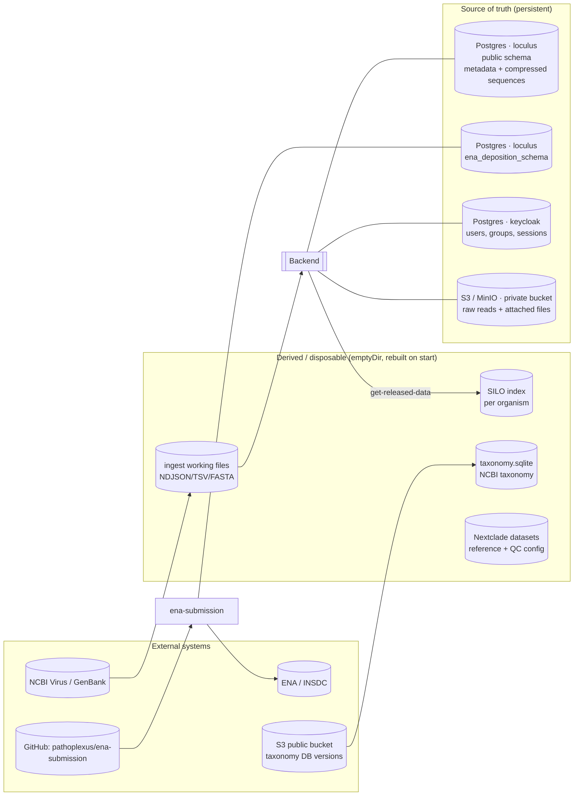
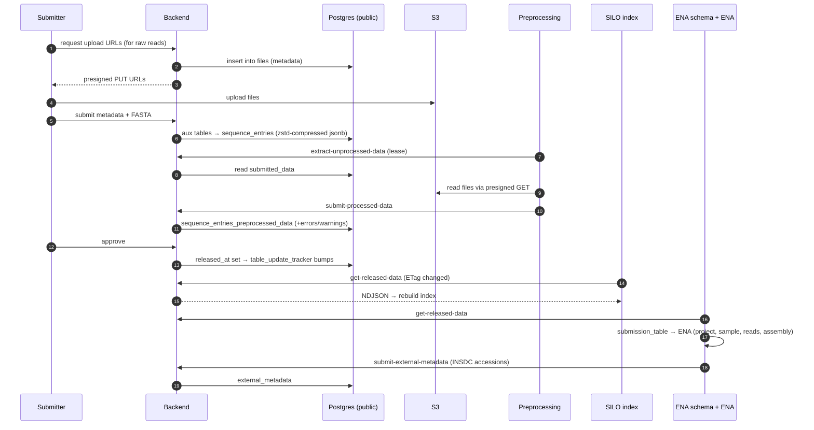

# Loculus: where the data lives

> Snapshot from 2026-11-23, based on `backend/docs/db/schema.sql`, the Flyway migrations, the Helm templates and the service code.
> Local file, ignored through `.git/info/exclude`.

**Short answer:**
- **Postgres is the source of truth.** Metadata and the sequences themselves (zstd-compressed, inside `jsonb`) live in the main `loculus` database. ENA deposition state is in its own schema, and users are in a separate Keycloak database.
- **S3 holds files only**: raw reads and other attachments, uploaded through presigned URLs.
- **Everything else is derived and disposable.** The SILO search index, the taxonomy SQLite and Nextclade datasets are rebuilt or re-downloaded on pod start, on `emptyDir` volumes.

## Overview

---

## 1. Postgres: main database `loculus` (schema `public`)

- **Owned and migrated by the backend:** 40 Flyway migrations in `backend/src/main/resources/db/migration`; the generated schema is in `backend/docs/db/schema.sql`.
- **Production:** an external, managed Postgres. The JDBC URL comes from the `database` secret (`values.yaml`: `jdbc:postgresql://loculus-database-service/loculus`).
- **Dev and preview:** `runDevelopmentMainDatabase: true` starts the `loculus-database-standin` pod. It has **no persistent volume**, so the data disappears when the pod restarts.

### Core sequence data
| Table / view | What it stores | Key columns |
|---|---|---|
| `sequence_entries` | One row per **(accession, version)** as submitted | `accession`, `version`, `organism`, `submitter`, `group_id`, `submitted_at`, `released_at`, `is_revocation`, **`submitted_data` jsonb** (metadata + **zstd-compressed sequences**), `archive_of_submitted_data` |
| `sequence_entries_preprocessed_data` | Output of the preprocessing pipeline, **per pipeline version** | `pipeline_version`, **`processed_data` jsonb** (normalized metadata, aligned sequences, insertions, compressed), `errors`, `warnings`, `processing_status`, lease fields (`processing_attempt_id`, `lease_until`) |
| `external_metadata` | Metadata added later by trusted services (INSDC accessions from ENA deposition) | `external_metadata_updater`, `external_metadata` jsonb |
| `sequence_entries_view` (view) | **What the API reads**: joins the entries, the current pipeline's output and the external metadata, and computes the status (`RECEIVED`, `IN_PROCESSING`, `PROCESSED`, `APPROVED_FOR_RELEASE`…) | — |
| `data_use_terms_table` | History of OPEN/RESTRICTED terms per accession | `data_use_terms_type`, `restricted_until`, `change_date` |

### Pipelines and processing control
| Table | Purpose |
|---|---|
| `current_processing_pipeline` | Which pipeline version is live per organism |
| `preprocessing_queue_versions` | Pipeline versions with an initialized work queue (lease-based queue, #7551) |
| `compression_dictionaries` | **zstd dictionaries** (`dict_contents` bytea) used to compress sequences, typically built from the organism's reference genome |
| `table_update_tracker` | "Last modified" per (table, organism, pipeline version), filled by triggers; drives ETags for SILO and the website (see task 04) |
| `task_lock` | Distributed locks for scheduled backend tasks |

### Submission staging (temporary)
| Table | Purpose |
|---|---|
| `metadata_upload_aux_table` | Parsed metadata rows of an in-flight upload (`upload_id`, metadata jsonb, file references) |
| `sequence_upload_aux_table` | Compressed sequences of an in-flight upload, keyed by `fasta_id` |

Both are filled during `submit`/`revise`, mapped into `sequence_entries` (`UploadDatabaseService.mapAndCopy`) and then cleaned up.

### Users, groups and governance
| Table | Purpose |
|---|---|
| `groups_table` | Submitting groups (name, institution, address, contact email) |
| `user_groups_table` | Membership: Keycloak username ↔ group |
| `audit_log` | Who did what (approvals, group changes…) |

### SeqSets (citable collections)
| Table | Purpose |
|---|---|
| `seqsets` | A SeqSet version (name, description, DOI, owner) |
| `seqset_records` | The accessions in a SeqSet (focal or background) |
| `seqset_to_records` | Join table, being removed (#7783, PR #7805) |
| `seqset_citation_source`, `seqset_to_citation_source` | Citation tracking |

### File metadata
| Table | Purpose |
|---|---|
| `files` | **Metadata only** for files in S3: `id`, `uploader`, `group_id`, `size`, multipart upload state, `marked_for_deletion_at`. The bytes live in S3 |

---

## 2. Postgres: ENA deposition (`ena_deposition_schema`)

Same database server, **separate schema**, owned by `ena-submission` (its own Flyway in `ena-submission/flyway/sql`).

| Table | Purpose |
|---|---|
| `submission_table` | One row per (accession, version) to deposit; overall `status_all` state machine |
| `project_table` | BioProject per (group, organism) |
| `sample_table` | BioSample per sequence entry |
| `raw_reads_table` | Read runs (ERR/SRR) when raw reads are attached |
| `assembly_table` | Assemblies (GCA) submitted with webin-cli |

Results flow back to the backend as `external_metadata` (INSDC accessions).

---

## 3. Postgres: Keycloak database (`keycloak`)

- **A separate database** (`keycloak-database` secret; `loculus-keycloak-database` pod in dev).
- **Holds:** users, credentials, roles, sessions, ORCID links and the realm settings.
- **Seeding:** the realm is imported at start from `keycloak-config-map.yaml`.
- The backend only stores **usernames** (in `submitter`, `user_groups_table`, …), never credentials.

---

## 4. S3 / MinIO: object storage

- **Private bucket** (`s3.bucket`, e.g. `loculus-preview-private`). In dev, a **MinIO** pod stands in for S3.
- **What's in it:** user-uploaded files (raw reads in FASTQ/BAM and other attachments, up to **5 GiB** each, `maxFileSizeBytes`).
- **How it flows:**
  - the backend issues **presigned PUT URLs** for uploads, including multipart (`S3Service.kt`), and records them in `files`;
  - preprocessing and raw-reads-processing read the files through **presigned GET URLs**;
  - released files are served to users the same way.
- **Garbage collection** of orphaned files (`s3.gcEnabled`, retention `gcOrphanRetentionPeriodMinutes: 10080` = 7 days).
- **Public bucket** (`loculus-public`): versioned **NCBI taxonomy SQLite** databases built by `taxonomy/ncbi_tax_download`.

---

## 5. Derived and ephemeral data (safe to lose)

| Data | Where | Built from | Lifetime |
|---|---|---|---|
| **SILO index** per organism | `emptyDir` volumes `lapis-silo-shared-data` and `lapis-silo-input-data-cache` | `get-released-data` NDJSON, transformed by the SILO importer | Rebuilt on every data change and on pod restart (incremental updates: #7733) |
| **Taxonomy DB** | `emptyDir` (`/data/taxonomy.sqlite`) | Downloaded by an init container from the public bucket (`taxonomyService.dbVersion`) | Per pod |
| **Nextclade datasets** | Preprocessing container | Downloaded at start from the dataset URL in the organism config | Per pod |
| **Ingest working files** | CronJob pod | NCBI `datasets` download, then transforms | Per run; the durable state is the **`hash`** metadata field stored in Loculus, compared on the next run |
| **Website cache** | `emptyDir` | Runtime config and responses | Per pod |
| **Keycloak theme** | `emptyDir` | keycloakify image (init container) | Per pod |

---

## 6. Configuration (not data, but stateful)

| What | Where |
|---|---|
| Organism schemas, metadata fields, preprocessing function mapping, website config | Helm `values.yaml` → **ConfigMaps** (rendered by `config-processor` init containers) |
| Secrets (DB credentials, S3 keys, Keycloak client secrets, ENA credentials) | Kubernetes **Secrets** (sealed secrets or external in production) |
| ENA submission list | GitHub repo `pathoplexus/ena-submission` (manually reviewed) |

---

## 7. Lifecycle of one sequence across stores

## Key points
- **Sequences live inside Postgres** as zstd-compressed `jsonb`, with dictionaries per organism, not in S3. This keeps everything transactional, but it's why large exports (`get-released-data`, task 05) and uploads (task 06) stress the database.
- **SILO is a cache.** It can always be rebuilt from Postgres, which is what makes incremental updates optional rather than a correctness problem.
- **Backups that matter:** the main Postgres (including `ena_deposition_schema`), the Keycloak Postgres and the private S3 bucket. Everything else can be regenerated.
- **Dev standin databases have no persistent volume**, so preview data is lost on a pod restart, which is intended.

## Dive deeper

- [Analyses: the generated charts, with takeaways](analyses.md)
- [Bottlenecks and optimization opportunities](bottlenecks.md)
- [Tasks: 18 concrete contributions](../tasks/README.md)
- [Python pipelines](python-pipelines.md)
- [CVEs and advisories](cves.md)
- [Security review](security.md)
