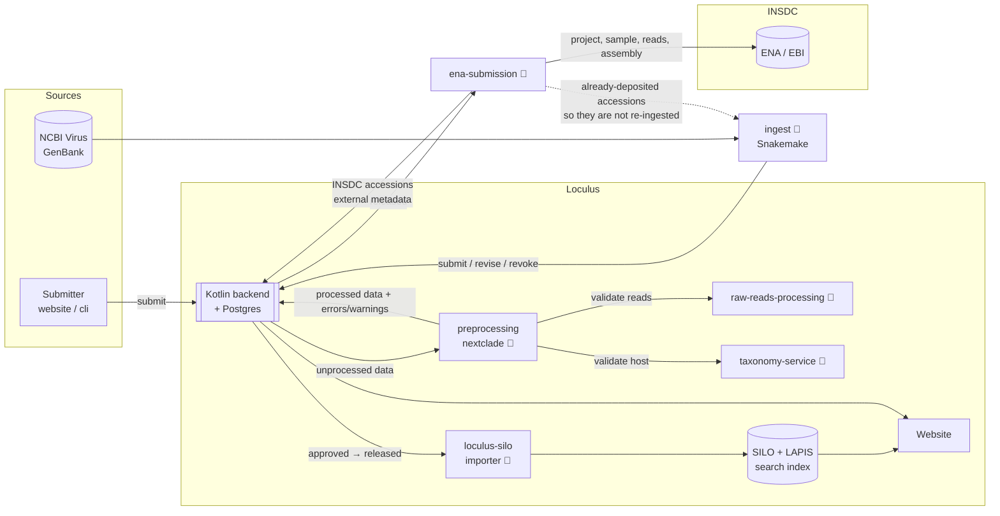
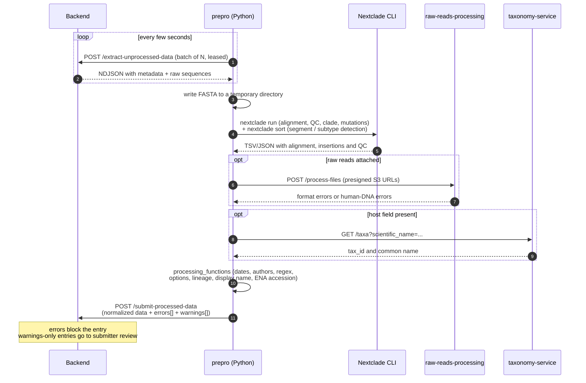
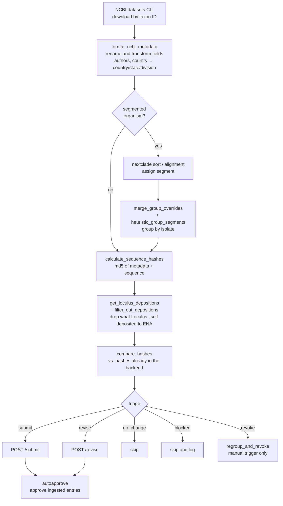
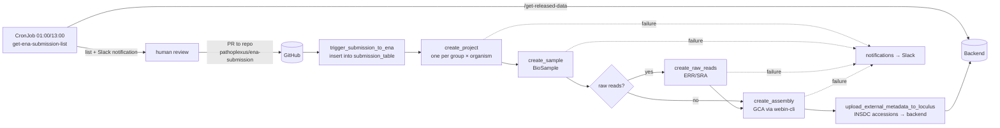
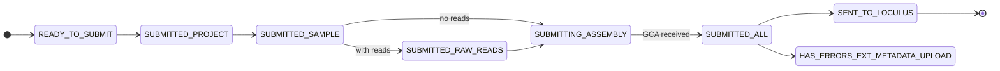
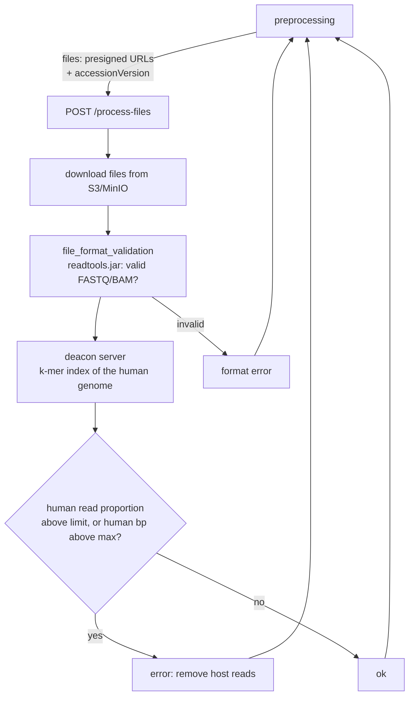
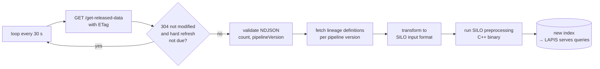
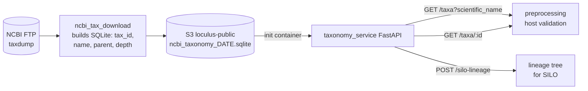

# Loculus: what the Python components process

> Snapshot from 2026-11-23, based on the READMEs and code in the repository.
> Local file, ignored through `.git/info/exclude`. Where each pipeline stores its data: see [`data-map.md`](data-map.md).

Python is ~25% of the code and appears in **9 components**. Almost all of them are **workers around the Kotlin backend**: they pull data, process it and push results back through the REST API. None of them touches the backend's tables directly, except `ena-submission`, which owns its own schema.

| Component | Lines | Kind | When it runs | What it processes |
|---|---|---|---|---|
| `preprocessing/nextclade` | 10,784 | worker (Deployment per organism × pipeline version) | continuously polls the backend | Nextclade alignment, QC and metadata normalization of submissions |
| `ena-submission` | 10,067 | Deployment + CronJob (01:00 and 13:00) | continuous | deposits released sequences to ENA/INSDC (project, sample, reads, assembly) |
| `ingest` | 4,390 | CronJob (Snakemake) | scheduled per organism | imports sequences from NCBI Virus/GenBank into Loculus |
| `cli` | 4,706 | user CLI | on demand | login, submit and download from the command line (in development) |
| `raw-reads-processing` | 2,039 | FastAPI service | called by preprocessing | validates read files (FASTQ/BAM) and rejects those containing human DNA |
| `loculus-silo` | 1,912 | worker | every 30 s | downloads released data, transforms it and builds the SILO search index |
| `taxonomy` | 991 | FastAPI service + build job | continuous | NCBI taxonomy lookups (host validation, lineages) |
| `preprocessing/dummy` | 310 | test worker | dev and CI | fake preprocessing that accepts or rejects without real analysis |
| `kubernetes/config-processor` | ~200 | init container | at every pod start | injects secrets and fetches external references into config files |

---

## 1. Overview: the lifecycle of a sequence

---

## 2. Preprocessing (Nextclade): from raw submission to validated data

The central component: every submitted sequence goes through it before human review. There is one instance per organism and pipeline version (`_preprocessingFromValues.tpl`).

**Processing functions** (`processing_functions.py`, 1,652 lines): `check_date`, `parse_date_into_range`, `parse_and_assert_past_date`, `parse_timestamp`, `concatenate`, `check_authors`, `extract_regex`, `check_regex`, `process_options`, `is_above_threshold`, `is_variant`, `assign_custom_lineage`, `build_display_name`, `resolve_host_taxon_id`, `scientific_name_from_id`, `common_name_from_id`, `check_ena_accession`. In `values.yaml`, each metadata field maps to one of these functions plus its arguments.

---

## 3. Ingest: import from NCBI without duplicates

Runs as a Kubernetes CronJob driving a Snakemake DAG. The trickiest part is **segmented viruses**: NCBI stores each segment separately, while a Loculus entry groups all segments of a sample.

Known bottleneck: `prepare_files.py` uses list membership for `to_submit`/`to_revise`/`to_revoke`, which is O(n²) (#7443, task 01).

---

## 4. ENA submission: deposit to INSDC

Once a sequence is released in Loculus it can be deposited to ENA (EBI), which mirrors to GenBank and DDBJ. The state of each (accession, version) lives in its own tables (`ena_deposition_schema`).

---

## 5. Raw reads: validation and human-data protection

A small FastAPI service with one endpoint (`POST /process-files`). It protects **privacy**: reads from clinical samples can contain the patient's DNA.

---

## 6. SILO importer: make the data searchable

Full rebuild on every change; incremental import is in progress (#7733, PRs #7746 and #7747).

---

## 7. Taxonomy: NCBI taxonomy lookups

---

## Takeaways

- **The Kotlin backend owns the state.** The Python components are stateless workers that talk to it through the API, so each one scales and can be replaced independently. `ena-submission` is the exception, with its own state-machine schema.
- **External binaries do the heavy lifting:** Nextclade (Rust), SILO (C++), deacon (Rust), readtools (Java) and NCBI `datasets`. Python orchestrates, transforms metadata and handles errors.
- **The risks from the other analyses:**
  - bus factor 1 on preprocessing, ENA and ingest;
  - Nextclade pinned at 3.24.0 (reverted on purpose in #7780);
  - Nextclade deliberately pinned in Dependabot's conda config (`ignore`, #7784);
  - `processing_functions.py` as a hotspot;
  - the `uv` CVE in `ena-submission`.
- **Four dependency managers coexist:** conda/micromamba (prepro, ingest, ENA, raw-reads, taxonomy), uv (cli), pip (dummy, config-processor) and pyproject. Standardizing them is an easy proposal.

## Dive deeper

- [Analyses: the generated charts, with takeaways](analyses.md)
- [Bottlenecks and optimization opportunities](bottlenecks.md)
- [Tasks: 18 concrete contributions](../tasks/README.md)
- [Data map: where data lives](data-map.md)
- [CVEs and advisories](cves.md)
- [Security review](security.md)
